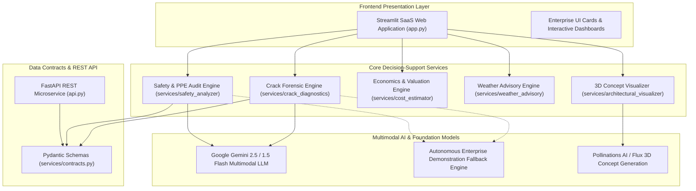

# Structura AI — Multimodal Construction Intelligence Platform

[](https://www.python.org/)
[](https://streamlit.io/)
[](https://fastapi.tiangolo.com/)
[](LICENSE)

**Structura AI** is an enterprise-grade, multimodal artificial intelligence decision-support platform engineered for construction project managers, safety inspectors, structural engineers, and real estate developers.

The platform unites computer vision, structural engineering forensics, CPWD civil economics, and meteorological risk intelligence into a unified, high-performance web suite.

---

## 🌟 Key Capabilities

### 1. Site Safety & PPE Compliance Audit
- **Multimodal Visual Inspection:** Audits on-site imagery for mandatory worker personal protective equipment (helmets, high-visibility reflective vests, steel-toe boots, fall arrest harnesses).
- **Standards-Based Evaluation:** Validates compliance under **OSHA 1926** (Safety and Health Regulations for Construction) and Indian Standards (**IS 2925 / IS 3696**).
- **Automated Hazard Triage:** Identifies site hazards (fall risks, tripping hazards, electrical routing) classified by severity (*Critical, High, Medium, Low*) with immediate corrective engineering remedies.
- **Exportable Reports:** Generates structured compliance checklists and downloadable JSON audit reports.

### 2. Concrete Crack Diagnostics & Structural Forensics
- **Morphology Classification:** Analyzes concrete surfaces to categorize crack defects (*Hairline, Structural Shear, Differential Settlement, Thermal Expansion, Spalling*).
- **Aperture & Risk Estimation:** Estimates crack width in millimeters and evaluates against **IS 456:2000 Clause 35.3.2** permissible crack thresholds.
- **Root Cause & Repair Engineering:** Outlines probable root causes and specifies actionable structural repair methodologies (e.g. ASTM C881 epoxy pressure injection, CFRP carbon-fiber wrapping).

### 3. Construction Economics, Planning & Valuation (INR)
- **Regional Cost Indexing:** Accurate cost estimation across Indian Tier 1, Tier 2, and Tier 3 metropolitan zones.
- **Financial Metrics:** Computes total project budget, capital expenditure (CapEx) incurred to date, and current market valuation in INR (Lakhs & Crores).
- **Material Takeoff Quantification:** Calculates required quantities of **TMT Fe500D steel** (MT), **53-grade Portland cement** (bags), manufactured sand (CFT), and coarse aggregates.
- **3D Concept Visualization:** Integrated architectural concept generator streaming photorealistic 3D elevations via Flux architectural rendering models.

### 4. Weather-Aware Site Advisory & Multi-Turn Engineering Assistant
- **Micro-Climate Hazard Protocols:** Dynamic safety advisories for adverse weather conditions (*High Wind / Gale, Heavy Monsoon Rain, Extreme Heat Wave, Normal*).
- **Safety Interlocks:** Triggers mandatory operational guidelines (e.g. crane windmilling, electrical de-energization, hot-weather concrete curing retarding agents).
- **Interactive Engineering Chatbot:** Multi-turn AI assistant grounded in civil engineering standards and site protocols.

### 5. Strict Pydantic JSON Data Contracts
- Validates all inputs and outputs through standardized schemas (`PPEAuditResult`, `CrackDiagnosisResult`, `CostValuationEstimate`, `WeatherSafetyAdvisory`), ensuring zero-breakage integration.

---

## 🏗️ Architecture Overview



---

## 🚀 Quickstart & Local Setup

### Prerequisites
- Python 3.9 or higher
- Git

### 1. Clone the Repository
```bash
git clone https://github.com/<your-username>/structura-ai.git
cd structura-ai
```

### 2. Create and Activate Virtual Environment
```bash
# Windows
python -m venv venv
.\venv\Scripts\activate

# macOS / Linux
python3 -m venv venv
source venv/bin/activate
```

### 3. Install Dependencies
```bash
pip install -r requirements.txt
```

### 4. Launch the Web Application
```bash
streamlit run app.py
```
The application will launch automatically in your default browser at `http://localhost:8501`.

*(Optional)* To run the FastAPI microservice alongside:
```bash
uvicorn api:app --reload --port 8000
```
API documentation will be available at `http://localhost:8000/docs`.

---

## ☁️ 1-Click Cloud Deployment (Streamlit Community Cloud)

1. Push this repository to your GitHub account as a **Public** repository.
2. Navigate to [share.streamlit.io](https://share.streamlit.io).
3. Connect your GitHub account and click **"New app"**.
4. Select your repository, branch (`main`), and set the main file path to:
   ```text
   app.py
   ```
5. Click **"Deploy"**. Your live production instance will be ready in under 60 seconds with an active HTTPS link:
   `https://<your-app-name>.streamlit.app`

---

## 🔒 Configuration & Authentication

- **Gemini API Key (Optional):** Enter your Google Gemini API key in the sidebar for live multimodal LLM processing.
- **Enterprise Demonstration Mode:** If no API key is provided, Structura AI automatically operates in demonstration mode with pre-calibrated forensic datasets, ensuring complete end-to-end functionality.

---

## 📄 License
This project is licensed under the Apache License 2.0.
